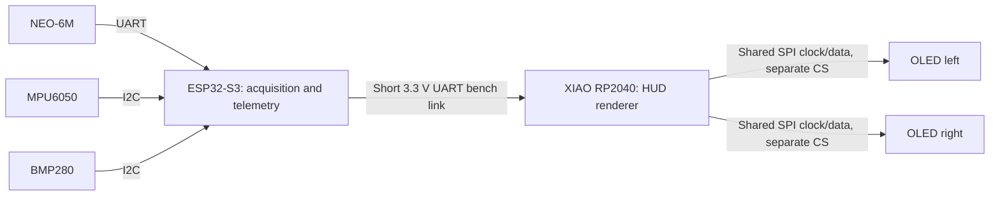

# Proposed architecture

Status: design proposal, not an as-built schematic. Owned parts are confirmed; wiring and performance are unverified.

## Responsibilities and interfaces

The ESP32-S3 reads and timestamps sensors, validates GPS fixes, estimates derived values, and sends compact telemetry. The RP2040 renders a minimal HUD and independently times out stale packets. Keep display updates independent of sensor polling.

For initial OLED tests, use SPI with separate chip selects and shared clock/data. Confirm the Waveshare interface jumpers, driver, reset/DC requirements, and pin budget before assigning XIAO pins. Do not assume a generic SSD1306 driver or an arbitrary resolution matches the owned displays. The candidate [Waveshare transparent model](https://www.waveshare.com/wiki/1.51inch_Transparent_OLED) is listed as 128×64 with SPI/I2C options; verify the actual units.

Use a short UART connection with crossed TX/RX and common ground at verified 3.3 V logic levels. Reserve a separate ESP32 UART for GPS. MPU6050 and BMP280 may share a local I2C bus after checking addresses, pull-ups, rail voltages, and exact breakout schematics. GPIO numbers remain unassigned because the ESP32-S3 board variant is unknown.

Proposed telemetry fields: protocol version, sequence, acquisition timestamp, GPS fix/age, speed in m/s, altitude source/value in metres, and validity flags. Define framing, length limits, checksum/CRC, units, and receiver timeout before integration. These are requirements, not an implemented protocol.

## Wearable link and power

Proposed placement: OLEDs and RP2040 at goggles; ESP32-S3 and battery in a protected jacket enclosure. If the MPU6050 is jacket-mounted it measures body/enclosure motion, not head orientation. Head tracking would require relocating it and revising the local sensor interface; do not run raw I2C down the wearable cable by default. Give GPS an appropriate antenna location and BMP280 a pressure vent protected from direct airflow and water.

For a longer cable, evaluate two 3.3 V RS-485 transceivers. Specify duplex mode, direction control, twisted pair, reference conductor, termination at physical endpoints, and one appropriate bias network. Inspect built-in module termination first. RS-485 is an electrical transport and does not supply power or define packet framing. A final cable pinout must cover power, return, data pair, voltage drop, strain relief, and breakaway behavior.

Bench power starts with USB. A later protected single-cell LiPo requires compatible charging, protection, fuse, switch, and regulated rails selected from measured peak loads and actual board power inputs. A 5 V boost is only a candidate if the chosen input topology requires it. Do not feed raw battery voltage into a 3.3 V rail or assume the XIAO includes charging. Verify USB/external power isolation and avoid backfeeding. Size the battery after measuring energy use; no runtime claim is established. Follow the selected cell's cold-temperature charging limits.

## Technical caveats

- NEO-6M fix quality, antenna placement, sky visibility, and output configuration limit telemetry. Record actual update rate; do not promise a rate from the model name alone. Distinguish ground speed from vertical motion and reject stale/no-fix data.
- MPU6050 is a six-axis accelerometer/gyro without a magnetometer. Bias and integration drift prevent reliable GPS-free position or stable absolute heading. GPS course is direction of travel when moving, not head heading.
- BMP280 pressure-derived altitude changes with weather and calibration. Its temperature reading is sensor temperature, not guaranteed ambient air temperature. It provides no humidity measurement. Wind pressure and enclosure heating affect readings.
- Sensor fusion is later experimental work requiring calibration, timing, reference frames, and validation. Do not label raw or integrated readings as an accurate INS.
- Transparent OLEDs do not automatically solve near-eye focus. Test focal distance, magnifying/collimating optics, eye relief, eyebox, contrast in snow/sunlight, reflections, and left/right alignment. A nominal “3×” lens is not a complete optical prescription.
- Two displays are not proof of stereoscopic AR, world-locked overlays, or comfortable binocular viewing. Start with a single readable display; keep the main view clear and provide a simple blank/off action.
- Condensation, water, cold, connector fatigue, battery protection, and snagging remain engineering tasks. Avoid modifying protective helmet structure or compromising the goggle lens.
