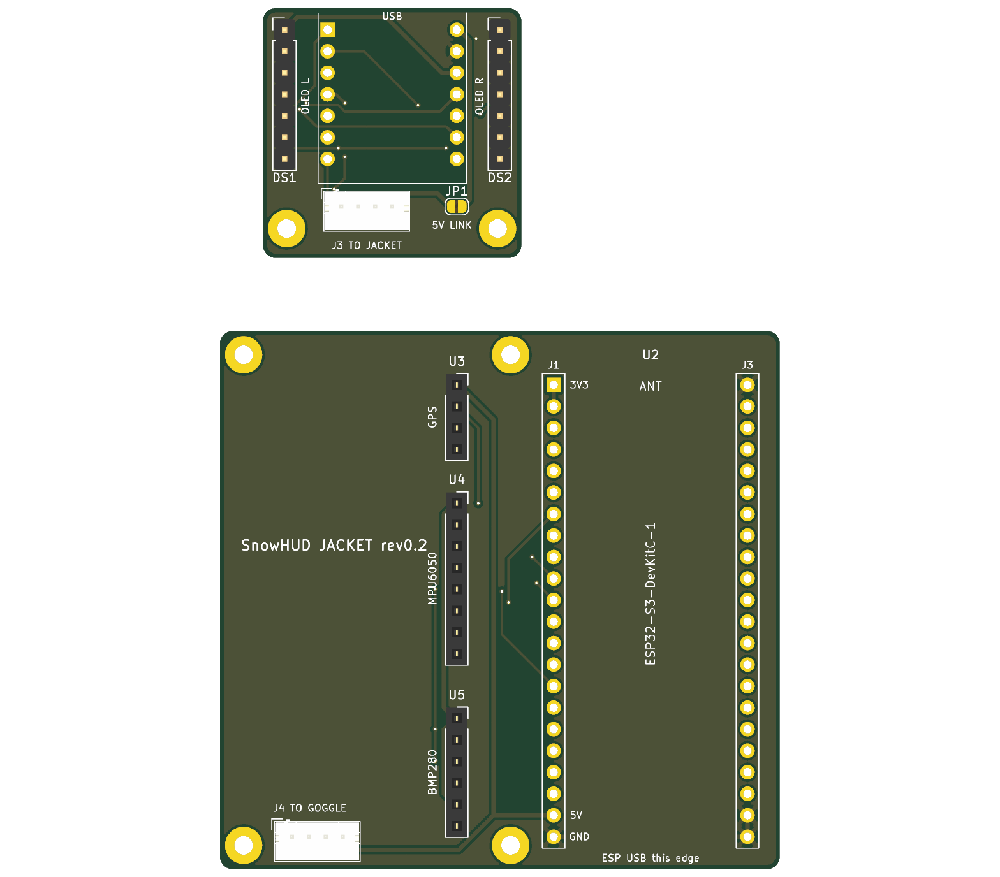
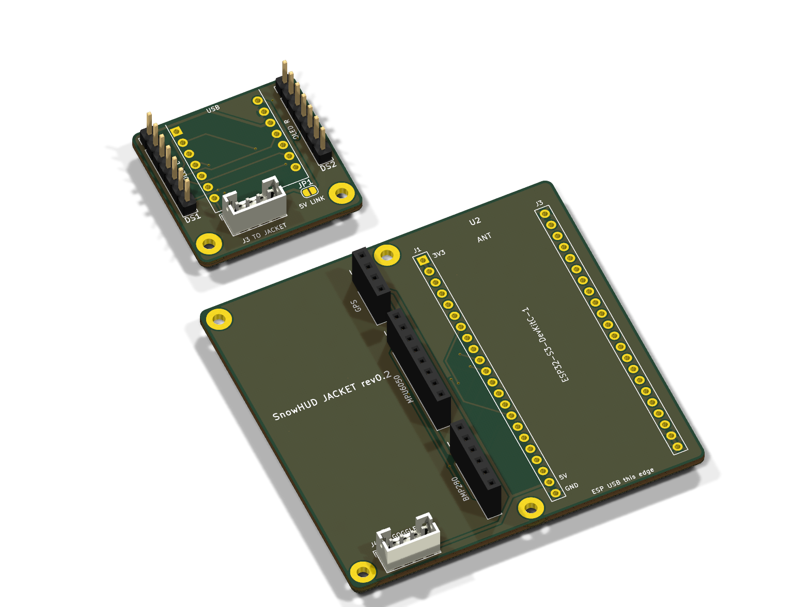

# SnowHUD KiCad project — rev 0.2 bench carrier PCBs

KiCad 10 project for two **carrier PCBs** that the owned development boards and breakout modules plug into:

| Board | Size | Carries |
| --- | --- | --- |
| **Goggle** (HUD renderer) | 30.5 × 29.5 mm | Seeed XIAO RP2040, two 7-pin OLED headers, JST-PH 4-pin cable connector, 5 V solder jumper, 2× M2 holes |
| **Jacket** (sensors / telemetry) | 66.0 × 63.5 mm | ESP32-S3-DevKitC-1 on 2×22 female sockets, NEO-6M / MPU6050 / BMP280 sockets, JST-PH 4-pin cable connector, 4× M2 holes |

Both boards are in **one** `SnowHUD.kicad_pcb` (two separate outlines), 2 copper layers, 1.6 mm, with GND pours on both layers.





> **Status: bench prototype, not revision A.** This is a direct wiring of the bench schematic. It does **not** yet meet the revision-A requirements in [`docs/PCB_PROTOTYPE.md`](../../docs/PCB_PROTOTYPE.md) (RS-485 tether, JST-GH 6-pin, input protection, test pads). See [Gaps vs. revision A](#gaps-vs-revision-a). Do not order boards until the [verification checklist](#verify-before-ordering) is complete.

## Files

| Path | What it is |
| --- | --- |
| `SnowHUD.kicad_pro` | Project file — open this in KiCad 10 |
| `SnowHUD.kicad_sch` | Schematic (rev 0.2) |
| `SnowHUD.kicad_pcb` | PCB layout, both boards |
| `SnowHUD.kicad_sym`, `sym-lib-table` | Project symbol library (module-level symbols) |
| `SnowHUD.pretty/`, `fp-lib-table` | Custom footprints: `XIAO_RP2040_THT`, `ESP32-S3-DevKitC-1_Socket` |
| `SnowHUD.kicad_dru` | Custom DRC rule (allows 1 thermal spoke; those pads are also trace-connected) |
| `SnowHUD_schematic.pdf` | Schematic PDF |
| `fab/SnowHUD_rev0.2_gerbers.zip` | Gerbers + Excellon drill, ready to upload to a fab (after verification!) |
| `fab/gerbers/` | Same files unzipped, plus drill map PDF and Gerber job file |
| `fab/drc_report.txt`, `fab/erc_report.txt` | Check reports at time of commit |
| `images/` | Rendered top / bottom / 3D views |
| `scripts/make_fp.py` | Generates the two custom footprints |
| `scripts/build_pcb.py` | Generates the whole PCB (placement, routing, pours) from the netlist |

## Check results (at commit)

- **ERC:** 0 violations.
- **DRC:** 0 violations, 0 unconnected items, 0 schematic-parity issues (run with `--schematic-parity --refill-zones`).

## Schematic changes from rev 0.1

The original rev 0.1 bench-wiring schematic had no physical connectors between the goggle and jacket halves. To make real PCBs, rev 0.2 adds:

1. **J3 (goggle) and J4 (jacket):** JST-PH 4-pin vertical connectors (`B4B-PH-K`) for the helmet cable.
2. **JP1 (goggle):** 2-pad solder jumper between cable 5 V and the XIAO `5V` pin (that pin was previously no-connect).
3. **Per-board net names on the goggle side** (`GND_HUD`, `HUD_RX`, `HUD_TX`, `+5V_CABLE`, `+5V_HUD`). The goggle and jacket nets connect **only through the cable**. Each PCB then passes DRC on its own, with no copper "connections" between the two board outlines.
4. Footprints assigned to every symbol, and a cable note added to the schematic.

All rev 0.1 pin assignments are unchanged.

## Cable (straight-through, 4 wires, JST-PH 2.0 mm)

| J4 pin (jacket) | Jacket net | → | J3 pin (goggle) | Goggle net | Notes |
| ---: | --- | :---: | ---: | --- | --- |
| 1 | `+5V_ESP` | → | 1 | `+5V_CABLE` | Reaches XIAO 5V only if JP1 is bridged |
| 2 | `GND` | ↔ | 2 | `GND_HUD` | Common ground (required) |
| 3 | `LINK_ESP_TX` (ESP GPIO4, U2TX) | → | 3 | `HUD_RX` (XIAO D7 / RX) | 3.3 V UART |
| 4 | `LINK_RP_TX` (ESP GPIO5, U2RX) | ← | 4 | `HUD_TX` (XIAO D6 / TX) | 3.3 V UART |

**JP1:** bridge it to run the XIAO from the jacket's 5 V. **Leave it open whenever the XIAO also has its own USB cable plugged in**, so the two 5 V sources aren't tied together.

> The 3.3 V single-ended UART is fine for a short bench cable. For the real helmet-length tether, the architecture calls for RS-485 transceivers. That is a revision-A change.

## Pin map

### Goggle board

| XIAO pin | Net | Goes to |
| --- | --- | --- |
| D0 | `OLED_CS_L` | DS1 pin 5 (CS) |
| D1 | `OLED_CS_R` | DS2 pin 5 (CS) |
| D2 | `OLED_DC` | DS1 / DS2 pin 6 |
| D3 | `OLED_RST` | DS1 / DS2 pin 7 |
| D6 / TX | `HUD_TX` | J3 pin 4 |
| D7 / RX | `HUD_RX` | J3 pin 3 |
| D8 / SCK | `SPI_SCK` | DS1 / DS2 pin 4 (CLK) |
| D10 / MOSI | `SPI_MOSI` | DS1 / DS2 pin 3 (DIN) |
| 3V3 | `+3V3_XIAO` | DS1 / DS2 pin 1 (VCC) |
| GND | `GND_HUD` | DS1 / DS2 pin 2, J3 pin 2 |
| 5V | `+5V_HUD` | JP1 → J3 pin 1 |
| D4, D5, D9 | — | Unused (D4 suggested for a "blank display" button) |

OLED headers DS1 (left) and DS2 (right) use the order **VCC, GND, DIN, CLK, CS, DC, RST** (pin 1 = square pad). Set the Waveshare boards to 4-wire SPI.

### Jacket board

| ESP32-S3 pin (header J1 position) | Net | Goes to |
| --- | --- | --- |
| 3V3 (J1-1, J1-2) | `+3V3_ESP` | MPU6050 VCC, BMP280 VCC + CSB |
| 5V (J1-21) | `+5V_ESP` | GPS VCC, J4 pin 1 |
| GND (J1-22, J3-1, J3-21, J3-22) | `GND` | All modules, J4 pin 2 |
| GPIO4 (J1-4) | `LINK_ESP_TX` | J4 pin 3 |
| GPIO5 (J1-5) | `LINK_RP_TX` | J4 pin 4 |
| GPIO7 (J1-7) | `MPU_INT` | MPU6050 INT |
| GPIO8 (J1-12) | `I2C_SDA` | MPU6050 SDA, BMP280 SDA |
| GPIO9 (J1-15) | `I2C_SCL` | MPU6050 SCL, BMP280 SCL |
| GPIO17 (J1-10) | `GPS_RX_IN` | GPS RX |
| GPIO18 (J1-11) | `GPS_TX_OUT` | GPS TX |

Module socket pin orders (pin 1 = square pad):
- **U3 GPS (GY-NEO6MV2):** VCC, RX, TX, GND
- **U4 MPU6050 (GY-521):** VCC, GND, SCL, SDA, XDA, XCL, AD0, INT (AD0 = GND → address 0x68; XDA/XCL unused)
- **U5 BMP280:** VCC, GND, SCL, SDA, CSB, SDO (CSB = 3V3 → I²C; SDO = GND → address 0x76)

The ESP32 footprint numbers pads by the SnowHUD symbol pin they carry. The 30 unused header positions are unnumbered pads with no net, so the DevKit is fully supported mechanically.

## Layout rules used

| Item | Value |
| --- | --- |
| Signal tracks | 0.30 mm |
| Power / GND tracks | 0.50 mm |
| Clearance | 0.20 mm (zones 0.30 mm) |
| Vias | 0.6 mm pad / 0.3 mm drill |
| Board-edge clearance | 0.5 mm |
| Pours | GND (jacket) / GND_HUD (goggle), both layers, thermal reliefs |

These are well within the standard 2-layer process of common low-cost fabs.

## Verify before ordering

These dimensions came from public documentation and the standard module layouts, **not from measuring the owned boards**:

- [ ] **ESP32-S3-DevKitC-1 header row spacing = 22.86 mm**, which matches the 25.4 mm board width in Espressif's [PCB drawing](https://dl.espressif.com/dl/PCB_ESP32-S3-DevKitC-1_V1_20210312CB.pdf). Measure the owned board. Also confirm J1 is on the left (top view, antenna up) and that pin 1 is 3V3.
- [ ] **XIAO RP2040 row spacing = 15.24 mm, 7 pins per side**, with USB-C overhanging the goggle board's top edge. Confirm standard (not Plus) board.
- [ ] **Module pin orders** above match the owned GPS / GY-521 / BMP280 / Waveshare boards.
- [ ] **Module body clearance:** the sockets are spaced, but the module bodies are not modeled (the GPS board is ~25 × 35 mm). Do a 1:1 paper print fit check (`File → Plot` or print the top-view PNG at scale).
- [ ] Physical fit of the goggle board in the frame/side arm.

If anything differs, fix it in the footprint (`SnowHUD.pretty`) or the symbol, then **Tools → Update PCB from Schematic** and re-route the affected tracks.

## Gaps vs. revision A

Compared with [`docs/PCB_PROTOTYPE.md`](../../docs/PCB_PROTOTYPE.md):

| Rev-A requirement | Rev 0.2 bench carrier |
| --- | --- |
| JST-GH 6-pin tether (GND, GND, +5V, A, B, AUX) | JST-PH 4-pin (5V, GND, TX, RX) |
| 3.3 V RS-485 transceivers + optional 120 Ω termination + bias | Direct 3.3 V UART (short cables only) |
| Resettable fuse, reverse-polarity protection, TVS on goggle 5 V input | None (JP1 only) |
| ESD protection at body connector | None |
| Test pads for 5V, 3V3, GND, A, B | None (header pins can be probed) |
| Battery / regulated 5 V stage | None (ESP32 powered from its own USB) |
| GPS antenna keepout, BMP280 vent | Not modeled |

## Editing and regenerating

- Normal workflow: open `SnowHUD.kicad_pro` in KiCad 10 and edit the schematic and PCB by hand.
- The layout was generated by `scripts/build_pcb.py`: a fixed placement plus a simple grid maze router (0.254 mm grid, 2 layers, 45° moves, vias), then GND pours. Re-running it **overwrites the PCB**, including manual edits:

```powershell
cd hardware\kicad\scripts
& "C:\Program Files\KiCad\10.0\bin\python.exe" make_fp.py
& "C:\Program Files\KiCad\10.0\bin\kicad-cli.exe" sch export netlist --format kicadsexpr -o SnowHUD.net ..\SnowHUD.kicad_sch
& "C:\Program Files\KiCad\10.0\bin\python.exe" build_pcb.py SnowHUD.net
& "C:\Program Files\KiCad\10.0\bin\kicad-cli.exe" pcb drc --schematic-parity --refill-zones -o drc.txt ..\SnowHUD.kicad_pcb
```

- Regenerate fab outputs after any change:

```powershell
cd hardware\kicad
$cli = "C:\Program Files\KiCad\10.0\bin\kicad-cli.exe"
& $cli pcb export gerbers -o fab\gerbers\ -l "F.Cu,B.Cu,F.Paste,B.Paste,F.Silkscreen,B.Silkscreen,F.Mask,B.Mask,Edge.Cuts" SnowHUD.kicad_pcb
& $cli pcb export drill -o fab\gerbers\ --generate-map --map-format pdf SnowHUD.kicad_pcb
```

**Fab note:** the Gerbers contain **both** boards as separate outlines. Most fabs treat that as a panel (sometimes extra cost). Alternatively, split them into separate files in KiCad before ordering.
