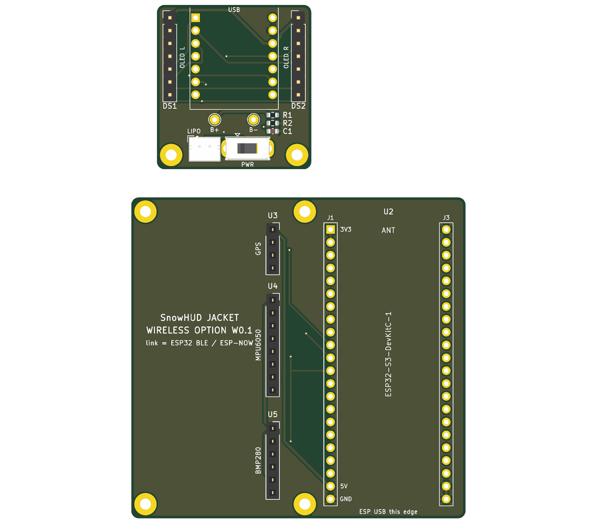
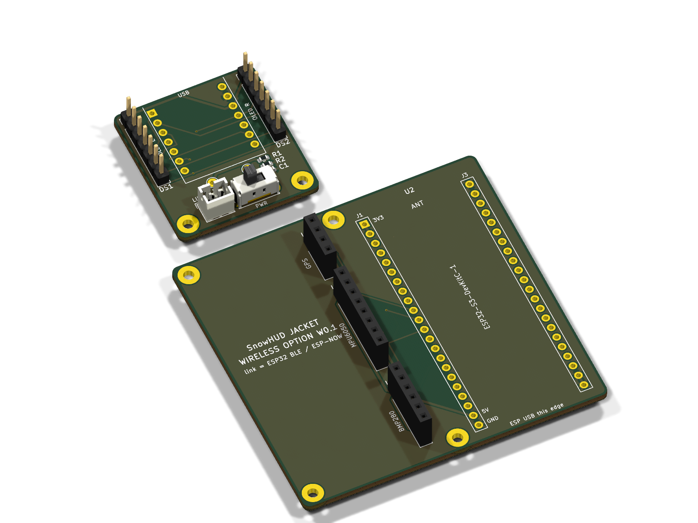

# Option: connection via Bluetooth / wireless (rev W0.1)

> **This folder is an alternative design, kept separate from the cable version.**
> The cable (tether) version lives in [`hardware/kicad/`](../kicad/README.md) and is unchanged.
> Pick **one** of the two for a build.

In this option the goggles and jacket have **no cable between them**. Both ends use an ESP32-S3 radio:

- **Jacket:** the ESP32-S3-DevKitC-1 you already own. It has Bluetooth LE and Wi-Fi built in.
- **Goggles:** the XIAO RP2040, which has no radio, is replaced by a **Seeed XIAO ESP32S3**. It has the same 14-pin XIAO size and layout, plus a built-in radio and LiPo charger.
- The goggles get their own small **LiPo battery**, on/off switch and battery-voltage monitor.





## Cable vs. wireless at a glance

| | Cable version (`hardware/kicad`, rev 0.2) | Wireless option (this folder, rev W0.1) |
| --- | --- | --- |
| Goggle controller | XIAO RP2040 | **XIAO ESP32S3** (new part) |
| Goggle ↔ jacket link | 4-wire JST-PH cable, 3.3 V UART | **Radio: ESP-NOW (recommended) or Bluetooth LE** |
| Goggle power | 5 V over the cable (JP1) or USB | **Own 1S LiPo** (charged by the XIAO over USB-C) |
| Goggle board | 30.5 × 29.5 mm | 30.5 × 32.5 mm (+3 mm for battery parts) |
| Jacket board | ESP32 + sensors + J4 cable connector | Same, **without** J4 |
| Batteries to charge | 1 (jacket, still to be designed) | 2 (goggle LiPo + jacket) |

## Which radio protocol?

The ESP32-S3 on both ends supports both:

- **ESP-NOW (recommended for goggle ↔ jacket):** Espressif's direct board-to-board packets. No pairing or router, very low latency, small payloads (≤250 bytes), which is ideal for sending speed, altitude etc. ~10×/s.
- **Bluetooth LE:** the standard option, also usable to talk to a **phone app** later. It needs pairing and has more protocol overhead.

ESP-NOW and BLE can coexist on the jacket ESP32 (for example ESP-NOW to the goggles, BLE to a phone). The hardware is identical for either; the choice is purely firmware.

## New parts for this option

These are in addition to the parts you already own. Full list: [`BOM.md`](BOM.md).

| Ref | Part | Qty | Notes |
| --- | --- | ---: | --- |
| U1 | **Seeed Studio XIAO ESP32S3** (not the "Sense" camera version) | 1 | Replaces the XIAO RP2040 on the goggle board. Comes with a U.FL antenna; **fit the antenna**. |
| J5 + battery | 1S 3.7 V LiPo with JST-PH 2.0 plug, ~300–500 mAh | 1 | e.g. 502535 (~5 × 25 × 35 mm, ~400 mAh). **Check plug polarity** (see below). |
| SW1 | C&K OS102011MS2Q slide switch (SPDT, THT) | 1 | Battery on/off |
| R1, R2 | 220 kΩ 0603 resistor | 2 | Battery divider (VBAT/2 → D5) |
| C1 | 100 nF 0603 capacitor | 1 | ADC filter |
| TP1, TP2 | Bare wire pads on the PCB | — | Nothing to buy. Two short wires to the XIAO's underside battery pads. |

The XIAO RP2040 is not needed for this option. Keep it for the cable version or for bench testing.

## How the goggle power works

```text
LiPo ──J5── BAT_RAW ──SW1── VBAT ──TP1 (B+)─wire─► XIAO ESP32S3 underside BAT+ pad
                              │                    (XIAO's built-in charger charges the LiPo from USB-C)
                              ├─R1 220k─┬─► D5 (GPIO6, ADC1) = VBAT/2
                              │         ├─R2 220k─ GND
                              │         └─C1 100nF─ GND
GND ─────────────────────────TP2 (B-)─wire─► XIAO underside BAT- pad
```

- The XIAO ESP32S3's battery connection is two **pads on its underside**, not header pins. TP1/TP2 sit right below the XIAO on the carrier: solder a short wire from each up to the XIAO's BAT+ / BAT− pads. Do this before soldering the XIAO onto its headers, and keep the wires clear of the header pins.
- **SW1 OFF disconnects the battery completely.** That means the LiPo **cannot charge while the switch is off**. Turn it on to charge from USB-C.
- **Battery monitor:** read D5 with the ADC and multiply by 2 for the battery voltage. The divider draws only ~9.5 µA, and nothing at all when SW1 is off.
- ⚠️ **LiPo polarity:** JST-PH battery leads are **not standardised**. Some batteries are wired the opposite way to others. Before plugging in, check with a meter that the red wire lands on the pad marked **B+/pin 1** (square pad of J5). Swap the pins in the plug housing if needed.

## Goggle board pin map (XIAO ESP32S3)

The OLED wiring is the same as the cable version, so OLED firmware can be shared.

| XIAO pin | ESP32-S3 GPIO | Net | Goes to |
| --- | --- | --- | --- |
| D0 | GPIO1 | `OLED_CS_L` | DS1 pin 5 |
| D1 | GPIO2 | `OLED_CS_R` | DS2 pin 5 |
| D2 | GPIO3 | `OLED_DC` | DS1 / DS2 pin 6 |
| D3 | GPIO4 | `OLED_RST` | DS1 / DS2 pin 7 |
| D5 | GPIO6 | `VBAT_SENSE` | R1/R2 divider (VBAT/2) |
| D8 / SCK | GPIO7 | `SPI_SCK` | DS1 / DS2 pin 4 |
| D10 / MOSI | GPIO9 | `SPI_MOSI` | DS1 / DS2 pin 3 |
| 3V3 | — | `+3V3_XIAO` | DS1 / DS2 pin 1 |
| GND | — | `GND_HUD` | DS1 / DS2 pin 2, J5, TP2 |
| D4, D6, D7, D9, 5V | — | unused | D4 free for a "blank display" button; D6/D7 (old cable UART) free |

> GPIO3 (D2) is an ESP32-S3 strapping pin (JTAG source select). Using it as the OLED DC output after boot is normally fine. If the board ever boots strangely with the OLEDs connected, move DC to the free D4.

## Jacket board

Identical to the cable version's jacket board ([pin map](../kicad/README.md#jacket-board)), except that **J4 is removed**. ESP32 GPIO4/GPIO5, which carried the cable UART, are now unused. The jacket is still powered from the DevKit's USB; the jacket battery stage is still an open item in [`docs/PCB_PROTOTYPE.md`](../../docs/PCB_PROTOTYPE.md).

## Antenna and placement notes

- Fit the U.FL antenna supplied with the XIAO ESP32S3 and route it **away from metal, carbon fibre, the battery and your head** where possible, e.g. along the outside of the goggle strap.
- The jacket DevKit's PCB antenna is at the 3V3/"ANT" end of the board. Don't bury it in a metal enclosure or right against the battery.
- Bodies absorb 2.4 GHz well. Over the ~0.5–1 m helmet-to-jacket distance ESP-NOW should be fine, but **test the link worn**, with both units in their enclosures, before trusting it.

## Battery runtime (estimate only, measure it)

Two OLEDs plus the ESP32-S3 with its radio might draw very roughly 80–150 mA, which would be about 2–4 h on a 400 mAh cell. That's less in the cold, because LiPos lose much of their capacity below freezing. Per the [roadmap](../../docs/ROADMAP.md), measure the real current before choosing the battery. Keeping the battery in a strap pouch close to the head helps in the cold. Ways to save power: lower OLED brightness, a lower ESP-NOW send rate, and light-sleep between updates.

## Files

| Path | What it is |
| --- | --- |
| `kicad/SnowHUD_Wireless.kicad_pro` | KiCad 10 project (open this) |
| `kicad/SnowHUD_Wireless.kicad_sch` / `_schematic.pdf` | Schematic rev W0.1 |
| `kicad/SnowHUD_Wireless.kicad_pcb` | Routed 2-layer layout, both boards in one file |
| `kicad/SnowHUD_Wireless.kicad_sym`, `SnowHUD_Wireless.pretty/` | This option's own symbol and footprint libraries (incl. the new XIAO ESP32S3) |
| `kicad/fab/SnowHUD_Wireless_W0.1_gerbers.zip` | Gerbers + drill (both boards) |
| `kicad/fab/SnowHUD_Wireless_bom.csv` | BOM exported from the schematic |
| `kicad/fab/SnowHUD_Wireless_positions.csv` | Component positions (for assembly services) |
| `kicad/fab/drc_report.txt`, `erc_report.txt` | 0 DRC violations / 0 unconnected / 0 parity issues; 0 ERC issues |
| `kicad/images/` | Top, bottom and 3D renders |
| `kicad/scripts/gen_sch.py` | Generates the schematic (reuses module symbols from the cable version) |
| `kicad/scripts/make_fp.py`, `build_pcb.py` | Footprints; placement + routing + pours (overwrites the PCB) |

Regenerate everything:

```powershell
cd hardware\option-bluetooth-wireless\kicad\scripts
$py  = "C:\Program Files\KiCad\10.0\bin\python.exe"
$cli = "C:\Program Files\KiCad\10.0\bin\kicad-cli.exe"
& $py gen_sch.py
& $py make_fp.py
& $cli sch export netlist --format kicadsexpr -o SnowHUD_Wireless.net ..\SnowHUD_Wireless.kicad_sch
& $py build_pcb.py SnowHUD_Wireless.net
& $cli pcb drc --schematic-parity --refill-zones -o drc.txt ..\SnowHUD_Wireless.kicad_pcb
```

`gen_sch.py` overwrites the schematic. Once you start editing the schematic by hand in KiCad, stop using it.

## Verify before ordering

- [ ] Everything in the cable version's [checklist](../kicad/README.md#verify-before-ordering): ESP32 row spacing (22.86 mm), XIAO row spacing (15.24 mm), module pin orders, module body clearance.
- [ ] XIAO ESP32S3 pin labels match the table above (check the [Seeed XIAO ESP32S3 wiki](https://wiki.seeedstudio.com/xiao_esp32s3_getting_started/)), and the location of its underside BAT pads relative to TP1/TP2.
- [ ] LiPo plug polarity matches J5 (pin 1 = B+, square pad).
- [ ] Battery and switch fit within the goggle strap mount.
- [ ] Radio link tested while worn (body blocking, cold, inside enclosures).
- [ ] Measured current and runtime are acceptable.

## Status

Design only. Nothing in this option has been built or tested. Firmware for ESP-NOW/BLE does not exist yet.
